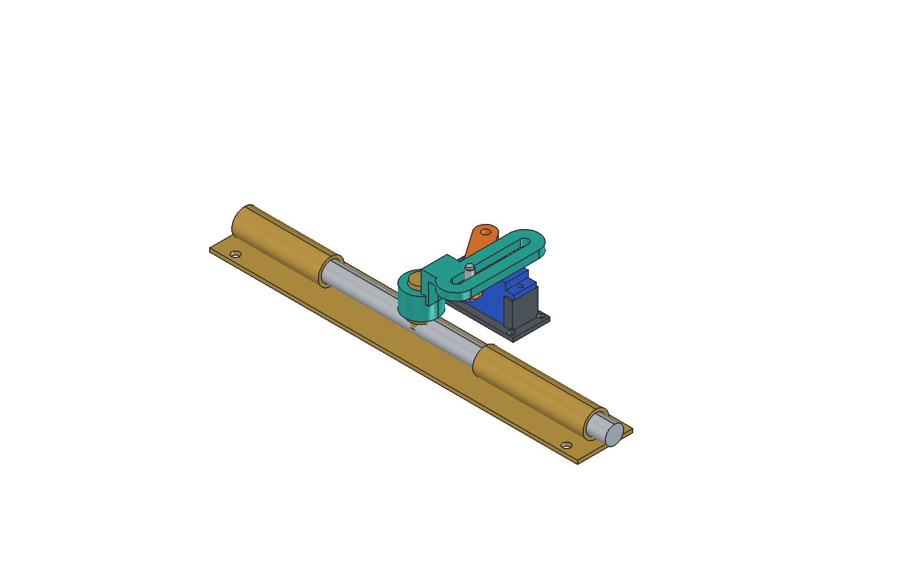

# Servo Door Lock V3

An open-source, 3D-printable pin-and-slot linkage for moving a sliding door
bolt with an SG90-style micro servo. This repository contains the V3 design,
not the later enclosure experiments or a complete electronic door-lock system.

**Fit-check prototype:** nominal CAD geometry has been checked, but printed
fit, adhesive strength, servo torque, wear, and reliable locking have not been
validated. Do not rely on this prototype for security, fire-door service, or
emergency egress. Keep an independent manual release.

## Download and Print

Download the repository using **Code > Download ZIP**, or download individual
STLs using GitHub's raw/download button. Do not save the HTML preview page as
an STL.

| File | Purpose |
| --- | --- |
| [Print_servo_arm_FIT_CHECK.stl](Print_servo_arm_FIT_CHECK.stl) | Orange extension bonded onto the supplied servo horn |
| [Print_clamp_yoke_FIT_CHECK.stl](Print_clamp_yoke_FIT_CHECK.stl) | Teal round handle socket with raised slotted arm |
| [Print_servo_mount_FIT_CHECK.stl](Print_servo_mount_FIT_CHECK.stl) | Optional, provisional servo mounting pedestal |

The first two files are the main joint parts. **STL coordinates are in mm;
print at 100% scale.** STL files do not contain units or colours.

- Print the servo arm flat. The yoke's raised bridge needs supports or a
  suitable alternate orientation; inspect the slicer preview carefully.
- PETG, 0.15-0.20 mm layers, 4 walls, and 40% infill are a starting point for a
  fit trial, not a validated strength specification.
- The metal lock, servo, white horn, and follower hardware in the assembly
  are references, not things to print.
- Check the actual servo ears before printing the optional pedestal.

## How It Moves

The servo rotates 90 degrees, from pointing down to pointing right in the
model's top view. A follower fixed to the servo arm slides along the other
arm's slot. The slot absorbs the perpendicular component of motion while the
metal bolt guides the handle in a straight line.

With a 35 mm follower radius, nominal bolt displacement is
`x = 35 * sin(angle)` mm: 0 mm at 0 degrees and 35 mm at 90 degrees. This is a
sliding linkage, not a gear train. The arms intentionally overlap at the pin.

## Reference Dimensions

| Dimension | cm | mm |
| --- | ---: | ---: |
| Lock backplate | 20 x 3 | 200 x 30 |
| Required straight bolt travel | 3.5 | 35 |
| Metal handle diameter | 1.0 | 10 |
| Available straight handle grip | 1.5 | 15 |
| Handle top above mounting surface | 3.0 | 30 |
| Printed socket bore / engagement depth | 1.06 / 1.2 | 10.6 / 12 |
| Servo axis to follower centre | 3.5 | 35 |
| Arm thickness, each | 0.4 | 4 |
| Gap between arms in assembly | 0.1 | 1 |
| Slot width / follower hole diameter | 0.46 / 0.32 | 4.6 / 3.2 |

The servo body is a simplified reconstruction based on the
[TowerPro SG90 envelope](https://towerpro.com.tw/product/sg90-analog/), not a
manufacturer CAD download. Ear locations, the horn profile, and lock barrels
are approximate. Measure your own hardware before fabrication.

## Hardware and Assembly

| Item | Quantity | Notes |
| --- | ---: | --- |
| SG90-style servo and its original horn/centre screw | 1 set | Keep the supplied spline interface |
| Sliding metal bolt with round 10 mm handle | 1 | Must slide freely through the intended 35 mm travel |
| Metal M3 machine screw | 1 | M3 x 16 mm is a starting fit trial with a plain nut; verify the actual stack |
| Matching M3 nut and retaining washers | 1 nut, 2 washers | Washers must retain the slot without fouling nearby parts |
| Smooth sleeve | 1 | 4 mm outside diameter, 3.1-3.2 mm bore, about 7.5 mm long |
| Suitable servo/door mounting hardware | As needed | Select for the actual servo, door material and thickness |

1. With power disconnected, secure the lock and servo to the same rigid
   mounting surface. Check the metal bolt's free movement.
2. Fit the original white horn using its original centre screw. The printed
   arm's centre hole is screw access, not a printed servo spline.
3. Align and bond the orange extension onto the horn. Bond the teal socket
   around the round handle. V3 uses adhesive attachments, not screw clamps.
   Hot glue was intended only for an unloaded prototype trial; it is not a
   validated permanent load-bearing connection.
4. Assemble the follower from bottom to top:
   **screw head / washer > servo arm > sleeve through the yoke slot >
   retaining washer > nut**. The sleeve rests on the servo arm and prevents
   the retaining washer from pinching the slotted yoke.
5. Verify sufficient thread engagement and full clearance around the screw
   head and nut. A taller locking nut may need a longer screw. The yoke must
   slide freely, with the sleeve carrying the retaining load. Do not glue
   the sleeve to the slot or tighten a washer directly against the yoke.
6. Test unpowered clearance first, then calibrate servo endpoints without
   forcing the lock against its stops. Stop immediately if it binds or stalls.

The earlier experimental printed screw and cap used **custom, non-M3
threads**. They are not included here and must not be mixed with M3 hardware.
Do not substitute a typical 6 mm outside-diameter spacer: it will not fit
the 4.6 mm slot.

## Edit, Preview and Rebuild

- [Round_Handle_Lock_V3.FCStd](Round_Handle_Lock_V3.FCStd): coloured native
  FreeCAD assembly, with individually selectable solids.
- [Round_Handle_Lock_V3.step](Round_Handle_Lock_V3.step): neutral CAD assembly.
- [build_model.py](build_model.py): editable geometry source in millimetres.
- [Preview_V3.FCMacro](Preview_V3.FCMacro): FreeCAD slider/playback, 0-90 degrees.
- [Rebuild_V3.FCMacro](Rebuild_V3.FCMacro): rebuilds and exports the assembly.

Tested with FreeCAD 1.1.4 and its bundled Python/PySide6. These scripts need
FreeCAD's `FreeCAD`, `Part`, and `MeshPart` modules; ordinary system Python
does not provide them.

1. Extract or clone the **whole repository**, keeping the files together.
2. Open the FCStd in FreeCAD for inspection. This is a set of separate solids,
   not a constraint-solved Assembly or a fully constrained Sketcher model.
3. Open `Preview_V3.FCMacro` through FreeCAD's macro interface and execute it
   for motion playback. Stop playback before manually moving parts.
4. To change dimensions, edit `build_model.py`. Some related coordinates are
   explicit, so changing only one number may not produce a valid redesign.
5. Run `Rebuild_V3.FCMacro` to rebuild. It **overwrites generated CAD, STEP,
   STL and validation files in this repository**, so commit or back up edits
   first. Manual changes to the FCStd are not read back into the generator.

The preview is kinematic only: it does not simulate force, friction, servo
electronics, collisions between every component, or real-world reliability.
There is no Arduino firmware or battery-lifetime claim in this release.

## Verification

`validation.json` records the generator's checks of 91 poses from 0 to 90
degrees, single-solid validity, and selected pairwise intersections.

Run `python3 verify_stls.py` to check the distributed binary STLs for finite
coordinates, non-degenerate triangles, consistently paired edges, positive
volume, dimensions, and bed placement. These are file/geometry checks, not
proof of printability or mechanical safety.

When reporting a fit issue, include the file/revision, measured hardware
dimensions, printer/material/settings, and a photo. Contributions that improve
mounting, tolerances, or test coverage are welcome.

## License and Attribution

Copyright 2026 akshadgupta72-glitch.

- CAD, STL, STEP, preview images, design data and documentation:
  **[CC BY 4.0](LICENSES/CC-BY-4.0.txt)**.
- Python scripts and FreeCAD macros: **[MIT](LICENSES/MIT.txt)**.

Suggested attribution: "Servo Door Lock V3 by akshadgupta72-glitch,
https://github.com/akshadgupta72-glitch/servo-door-lock-v3, CC BY 4.0."
Indicate changes when sharing modified design files. See [LICENSE.md](LICENSE.md)
for scope. External manufacturer documents and trademarks are not relicensed.
